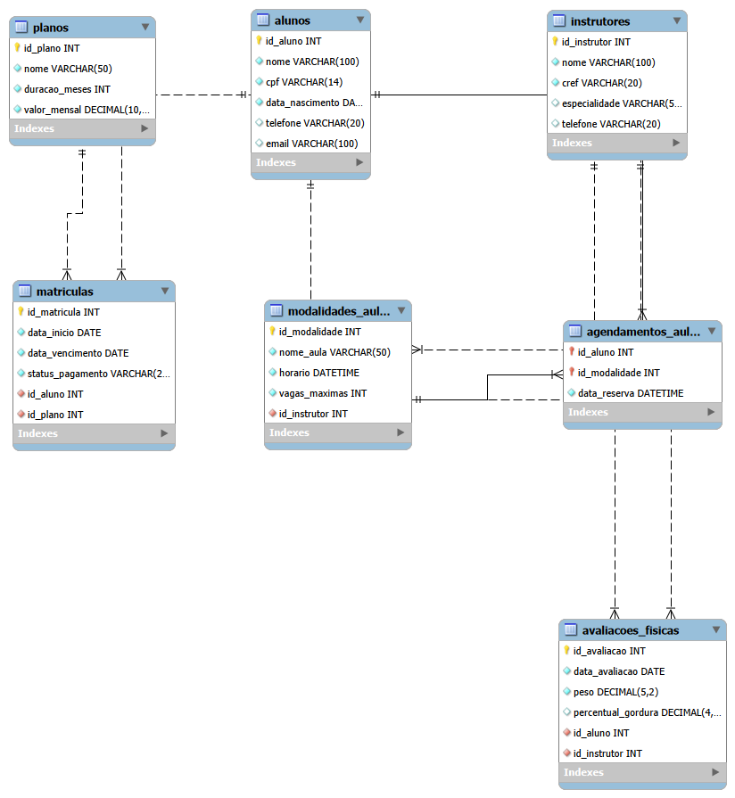

# Sistema de Gestão Academia FitLife

Sistema de banco de dados relacional desenvolvido para gerenciamento operacional de academias e acompanhamento de alunos.

---

## Sumário

- [Sobre o Projeto](#sobre-o-projeto)
- [Objetivo do Sistema](#objetivo-do-sistema)
- [Tecnologias Utilizadas](#tecnologias-utilizadas)
- [Modelagem Relacional (Diagrama EER)](#modelagem-relacional-diagrama-eer)
- [Estrutura do Banco de Dados](#estrutura-do-banco-de-dados)
- [Consultas SQL Implementadas](#consultas-sql-implementadas)
- [Backup e Restauração de Dados (Dump)](#backup-e-restauração-de-dados-dump)
- [Como Executar o Projeto](#como-executar-o-projeto)

---

## Sobre o Projeto

O FitLife Database System é uma solução de modelagem e implementação de banco de dados para a Academia FitLife (Atividade III - SEDUC). O projeto engloba desde a conceituação das regras de negócio até a normalização de dados e execução de consultas analíticas.

---

## Objetivo do Sistema

- **Automação do Controle de Planos:** Gerenciamento centralizado de matrículas e seus status financeiro.
- **Acompanhamento Físico:** Histórico de evolução biológica dos alunos (peso e % de gordura).
- **Gestão de Aulas e Instrutores:** Alocação de profissionais por modalidade e controle de reservas de vagas.
- **Eliminação de Redundâncias:** Estruturação normalizada garantindo a integridade dos dados.

---

## Tecnologias Utilizadas

- **SGBD:** MySQL 8.0
- **Ferramenta de Modelagem:** MySQL Workbench
- **Linguagem:** SQL (DDL, DML e DQL)
- **Versionamento:** Git & GitHub

---

## Modelagem Relacional (Diagrama EER)

O esquema relacional foi projetado observando as Regras de Normalização (1FN até 4FN):



---

## Estrutura do Banco de Dados

O banco de dados `fitlife_db` conta com 7 tabelas integradas por chaves estrangeiras (FK):

- `planos`: Cadastro dos pacotes comerciais, durações e mensalidades.
- `alunos`: Informações pessoais e de contato dos membros.
- `instrutores`: Registro dos profissionais de educação física e CREF.
- `matriculas`: Vínculo entre alunos e planos de acesso.
- `modalidades_aulas`: Catálogo de turmas, horários e capacidade máxima.
- `agendamentos_aulas`: Controle de inscrições dos alunos nas aulas coletivas.
- `avaliacoes_fisicas`: Registro de métricas e histórico de avaliações corporais.

---

## Consultas SQL Implementadas

O projeto dispõe de 15 consultas analíticas cobrindo:
- Junções de tabelas (`INNER JOIN`, `LEFT JOIN`).
- Funções de agregação (`SUM`, `AVG`, `COUNT`) e agrupamento (`GROUP BY`, `HAVING`).
- Subconsultas e ordens de classificação (`ORDER BY`).

> Os prints de comprovação da execução das 15 consultas estão organizados na pasta `/resultados_consultas`.

---

## Backup e Restauração de Dados (Dump)

A estratégia de backup foi elaborada para garantir a **integridade referencial**, **portabilidade de caracteres (UTF-8)** e **rastreabilidade das transações** do banco `fitlife_db`.

### 1. Parâmetros Técnicos do Utilitário `mysqldump`

Para a geração do backup completo via linha de comando (CLI), utilizam-se parâmetros avançados que asseguram a recriação limpa das tabelas e previnem falhas de validação de chaves estrangeiras durante a importação:

- `--routines`: Inclui Stored Procedures e Functions no arquivo de backup.
- `--triggers`: Preserva os gatilhos configurados nas tabelas.
- `--events`: Preserva eventos agendados no SGBD.
- `--add-drop-table`: Adiciona a cláusula `DROP TABLE IF EXISTS` antes de cada `CREATE TABLE`.
- `--single-transaction`: Executa o backup em uma única transação (para tabelas `InnoDB`), garantindo a consistência sem travar a escrita no banco (*table locking*).
- `--default-character-set=utf8mb4`: Mantém a codificação correta de acentuação e caracteres especiais em português.

### 2. Geração do Backup via Terminal (CLI)

#### A. Dump Completo (Estrutura DDL + Dados DML)
Executar no terminal do sistema operacional (substituindo `root` pelo usuário configurado no MySQL):

```bash
mysqldump -u root -p \
  --default-character-set=utf8mb4 \
  --routines \
  --triggers \
  --events \
  --single-transaction \
  --add-drop-table \
  fitlife_db > dump_fitlife_db_completo.sql
